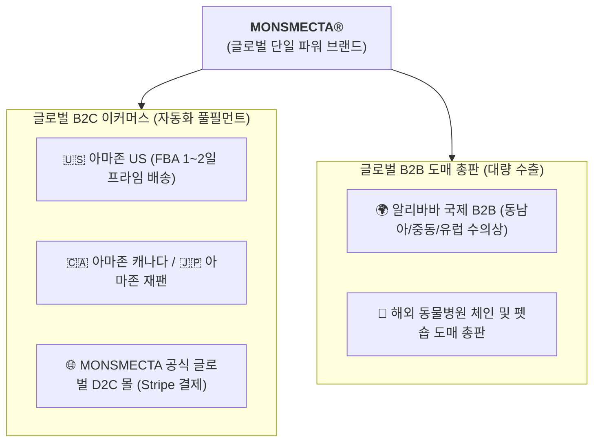
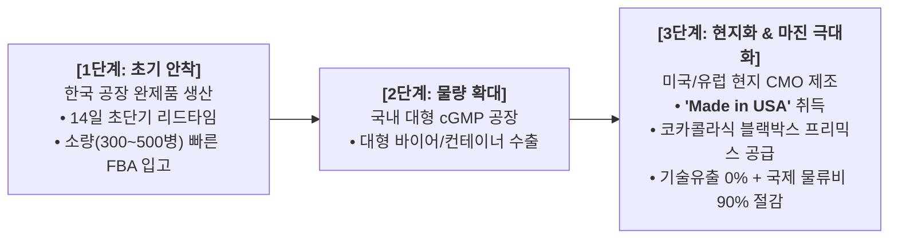

# 🐾 MONSMECTA® Global E-Commerce Master Blueprint
**Target Markets:** Amazon US / Global, Alibaba B2B, Shopee, Worldwide Pet E-Commerce  
**Brand Architecture:** Dr. James Hong's Clinical Veterinary Formula  
**Date:** 2026-10-24  
**Author:** CTO Antigravity (안그래) for James Hong (홍순일 대표님)

---

## 1. 🌐 브랜드 & 채널 믹스 전략 (Brand & Channel Matrix)

국내 동물병원 수의사들과의 신뢰 관계 및 가격 정책을 완벽히 방어하면서, 전 세계 시장에서는 단일 파워 브랜드로 시장을 장악하는 최상급 채널 포트폴리오입니다.

### [1.1] 공식 출원 및 지식재산권(IP) 정보
* **출원 상표:** MONSMECTA (Standard Character Mark)
* **출원 국가:** 미국 연방특허상표청 (USPTO)
* **원천 포뮬레이션 노하우 & 기술 권리자:** **Dr. James Hong (수의학 박사 홍순일) / AGROKOREA CO.,LTD. 100% 독점 소유**
* **수출업자 & 브랜드 소유주 (Consignor & Brand Owner):**
  * **AGROKOREA CO.,LTD. (한국아그로)**
  * 공식 영문 주소: `#1506 Seongji Building, 75 Keunwoomul-ro, Mapo-gu, Seoul, KOREA`
* **제조업자 (Production Establishment):**
  * **Mobio co. (엠오바이오)**
  * 공식 영문 주소: `10-25, Seokpo-ro 74beon-gil, Paltan-myeon, Hwaseong-si, Gyeonggi-do, KOREA`
* **정부 공인 글로벌 수출 증빙 3종 세트 (경기도지사 공식 선례 입증):**
  * 대한민국 지자체(경기도청 축산과)에서 발급하는 법정 영문 서식 3종을 통해 **제조자(Mobio co.)와 수출자(AGROKOREA CO.,LTD.)가 공식 공문서에 100% 병기** 발급됨:
    1. **Certificate of Free Sales (자유판매증명서 - 별지 제2호 서식):** 전 세계 쇼핑몰 및 세관에 한국 내 합법 유통 증명.
    2. **Certificate of Manufacture (제조증명서 - 별지 제3호 서식):** 사료관리법 기준 준수 제조 증명.
    3. **Certificate of Product Registration (제품등록증명서 - 별지 제4호 서식):** 성분등록번호 및 보증성분 공식 증명.

### [1.2] 수출 증명서 상 Consignee(수입업자) 표기 실무 가이드 (아마존 FBA 규정)
* **주의: Consignee란에 `Amazon` 단독 표기 절대 금지**
  * 아마존(Amazon.com Services LLC)은 세금 및 통관 책임을 지는 공식 수입자(IOR: Importer of Record)가 되는 것을 공식 약관상 엄격히 거부합니다. 아마존 FBA 창고는 '최종 배송지(Deliver to / Ship to)'일 뿐입니다.
* **경기도청 수출 3종 증명서 Consignee(수입업자) 기재 솔루션 (택 1):**
  1. **[1순위 추천 - 범용 오픈형]:** `TO WHOM IT MAY CONCERN` 또는 `OPEN FOR GLOBAL E-COMMERCE`로 발급 요청 (특정 바이어에 종속되지 않고 아마존, 알리바바, 쇼피 등 전 세계 쇼핑몰에 범용 사용 가능).
  2. **[2순위 - 포워더 IOR 연계]:** 미국 FBA 전담 운송 포워더(예: Cello Square, 로지스팟 등)의 미국 현지 통관 대리인(Customs Broker / US Agent) 명의 및 주소 기재.
  3. **[3순위 - 한국아그로 수입자 병기]:** `AGROKOREA CO.,LTD. c/o Amazon Fulfillment Center` 형태.
* **지정 상품 (상품류 제05류 - 미국 공식 명칭):**
  1. *Nutritional supplements for pets*
  2. *Dietary and nutritional supplements for animals*
  3. *Non-medicated additives for animal feed for use as nutritional supplements*
  4. *Animal feed additives for use as nutritional supplements*
  5. *Animal feed additive for use as a nutritional supplement for medical purposes*
  6. *Dietary and nutritional supplements*
* **제조 리드타임:** 발주 확정 후 **단 14일(JIT 초고속 생산)**
* **글로벌 정식 용량 규격:** **100ml (3.4 fl oz)** 액상 서스펜션

| 시장 구분 | 타깃 채널 | 브랜드명 | 제품 포지셔닝 및 유통 원칙 |
| :--- | :--- | :--- | :--- |
| **대한민국 (Domestic)** | **전국 동물병원** | **몬스멕타 (Monsmecta)** | • 수의사 전용 처방/유통 (동물병원 독점)<br>• 국내 온라인 쇼핑몰 유통 엄격 차단 (가격 붕괴 방지)<br>• 임상 데이터 수집 및 수의학 권위 앵커 |
| **대한민국 (Domestic)** | **국내 온라인 쇼핑몰** | **파보겔 (Parvogel)** | • 일반 반려인 D2C 전용 (네이버, 쿠팡, 자사몰)<br>• 동물병원과의 유통 마찰 원천 차단 |
| **전 세계 (Global / Worldwide)** | **전 세계 쇼핑몰 (Amazon, Alibaba 등)** | **MONSMECTA®** | • **전 세계 쇼핑몰 단일 브랜드 장악**<br>• 미국 특허청(USPTO) 상표 기반 독점 보호<br>• 글로벌 B2C (Amazon FBA) + 글로벌 B2B (Alibaba) 동시 전개 |

---

## 2. 🇺🇸 Amazon US 마스터 리스팅 카피 (High-Converting Copywriting)

### [2.1] 제품명 (Title) - 198자 최적화 (모바일 및 PC 검색 1위 점유)
```text
MONSMECTA Fast-Acting Dog & Cat Diarrhea Relief (100ml / 3.4 oz) – Natural Smectite Liquid Suspension for Loose Stool, Acute Digestive Upset & Gut Barrier Support – Vet Formulated by Dr. James Hong
```
* **포함된 검색 키워드:** Dog Diarrhea Relief, Cat Diarrhea, Loose Stool, Digestive Upset, Smectite, Gut Barrier Support, Vet Formulated.

---

### [2.2] 5대 핵심 불렛 포인트 (5 Feature Bullets)

1. **⚡ FAST-ACTING RELIEF FOR ACUTE LOOSE STOOL:**
   Engineered with pharmaceutical-grade purified Smectite (Diosmectite/Montmorillonite), MONSMECTA rapidly binds watery stool and coats the irritated gastrointestinal mucosa, restoring stool firmness often within 24 to 48 hours.

2. **🛡️ 3-TIER INTESTINAL BARRIER PROTECTION:**
   Unlike chemical stool binders, MONSMECTA creates a protective biocompatible shield over inflamed intestinal walls, adsorbing toxic bacterial endotoxins, gas, and pathogens while preserving beneficial gut microbiota and preventing fluid loss.

3. **👨‍⚕️ 30+ YEARS CLINICALLY TESTED VETERINARY FORMULA:**
   Developed and perfected in hospital clinical trials by veteran veterinary surgeon Dr. James Hong (Director of SNJ Animal Medical Center). Trusted across hundreds of animal hospitals as the frontline defense against dietary indiscretion, stress diarrhea, and weaning transitions.

4. **🥣 EASY-DOSE LIQUID SUSPENSION (NO PILL STRUGGLES):**
   No more forcing hard pills down your pet's throat. Simply shake well and administer directly via feeding syringe or mix seamlessly into wet food, broth, or favorite treats. Gentle on sensitive puppy and kitten stomachs.

5. **🌿 100% NON-SYSTEMIC & SAFE FOR ALL BREEDS:**
   MONSMECTA acts strictly within the intestinal lumen without being absorbed into the bloodstream, eliminating liver or kidney burden. Free from harsh antibiotics, artificial preservatives, dyes, and sugar. Safe for dogs, cats, puppies, and senior companions.

---

## 3. 🎨 Amazon A+ Content (EBC) 모듈별 비주얼 기획안

### 모듈 1: Hero Brand Banner (상단 메인 비주얼)
* **카피:** *"When Emergency Diarrhea Strikes: Trust What Veterinarians Use in the ICU."*
* **비주얼:** Dr. James Hong(수의학 박사)의 신뢰감 넘치는 수술복/진료 가운 착용 사진 + 몬스멕타 보틀 실물 + 미국 특허청(USPTO) 등록 마크 배지.

### 모듈 2: 3단계 독소 흡착 메커니즘 (Scientific Moat Diagram)
* **Step 1 (Adsorb):** 천연 스멕타이트 판상 구조가 장내 유해균 독소와 바이러스 입자를 자석처럼 흡착.
* **Step 2 (Shield):** 손상된 위장관 점막 상피세포에 얇은 생체 보호막을 형성하여 추가 출혈/염증 차단.
* **Step 3 (Restore):** 과도한 수분 배출을 막아 탈수를 예방하고 신속한 정상 변 형성.

### 모듈 3: 언제 먹여야 하나요? (When to Use)
* 음식 급변 또는 쓰레기 섭취(Dietary Indiscretion)로 인한 급성 설사
* 이사, 미용, 분양, 여행 등으로 인한 스트레스성 무른 변
* 이유기 강아지·고양이의 소화 불량 및 위장 장애
* 구토 후 장 점막 회복기 보조

### 모듈 4: 체중별 복용 가이드 (Weight-Based Dosage Chart)
* 미국 견주 맞춤 파운드(lbs) & 킬로그램(kg) 병기:
  * **Under 10 lbs (under 5kg):** 2.5 ml, 2~3 times daily
  * **10 - 25 lbs (5 - 11kg):** 5.0 ml, 2~3 times daily
  * **26 - 50 lbs (12 - 23kg):** 7.5 ml, 2~3 times daily
  * **Over 50 lbs (over 23kg):** 10.0 ml, 2~3 times daily

### 모듈 5: Dr. James Hong 원천 개발자 스토리 & 제조 품질 인증
* 대한민국 에스앤제이동물병원 30년 임상 철학 소개.
* cGMP / ISO 기준 제조 및 잔류농약·중금속 0% 무독성 검사 성적서 인포그래픽.

---

## 4. 🏷️ 미국 수출용 패키지 & 라벨 컴플라이언스 (FDA-CVM 가이드라인)

> [!IMPORTANT]
> **필수 선행 조건 (Gate 0): 정부 공식 영문 성분등록증 발급**  
> 라벨 디자인 수정 및 인쇄는 반드시 **대한민국 농림축산식품부/지자체 발행 '공식 영문 사료/보조사료 성분등록증'**이 발급된 직후 진행합니다. 정부 공문서상의 영문 성분명, 보증 함량(%), 등록번호를 1:1로 일치시켜야 미국 세관(CBP) 통관 및 아마존 카테고리 승인 시 100% 무결점을 보장받습니다.

미국 시장은 의약품(New Animal Drug)이 아닌 **'동물용 영양 보충제(Animal Dietary / Digestive Supplement)'**로 라벨을 설계해야 FDA 사전 허가 지연 없이 즉시 유통이 가능합니다.

1. **제품명 표기:** MONSMECTA™ Digestive Care Liquid for Dogs & Cats (정부 영문 등록명과 일치)
2. **용량 표기:** Net Contents: 3.4 fl oz (100 ml)
3. **주성분 분석 (Guaranteed Analysis per 5ml - 정부 영문등록증 수치 그대로 전사):**
   * Diosmectite (Montmorillonite Clay) ... XXX mg
   * Moisture (Max) ... XX%
4. **원료 표기 (Ingredients):** Purified Water, Smectite, Xanthan Gum, Natural Flavor.
5. **제조원 및 판매원 표기 (Manufacturer & Distributor Statement - FDA/FTC 공식 표준):**
   ```text
   Formulated & Developed by:
   Dr. James Hong, D.V.M., Ph.D.
   SNJ Animal Medical Center

   Manufactured for / Distributed by:
   AGROKOREA CO.,LTD.
   #1506 Seongji Building, 75 Keunwoomul-ro, Mapo-gu, Seoul, KOREA
   Homepage: www.agrokorea.kr | Tel: +82-2-6949-5708

   Manufactured by:
   Mobio co.
   10-25, Seokpo-ro 74beon-gil, Paltan-myeon, Hwaseong-si, Gyeonggi-do, KOREA
   ```
6. **주의 문구 (Cautionary Statement):**
   * *For veterinary and animal use only. Keep out of reach of children and pets.*
   * *If diarrhea persists for more than 48 hours or is accompanied by high fever, consult your veterinarian immediately.*
7. **바코드:** 미국 정식 GS1-128 / UPC-A 12자리 바코드 인쇄.

---

## 5. 🌏 글로벌 옴니채널 확장 로드맵 (Omnichannel Expansion)



---

## 6. 🚀 홍효선 대표님을 위한 무인 FBA 물류 아키텍처 (Zero-Labor Supply Chain)

**핵심 경쟁력:** 대표님의 공장은 발주 후 **단 14일이면 완제품 생산이 가능**하므로, 수천만 원의 재고를 창고에 묵혀둘 필요 없이 **'수요 기반 적시 생산(JIT: Just-In-Time)'**이 가능합니다.

### [6.1] 단계별 생산 & 글로벌 현지화 전략 (Scaling Strategy)



### [6.2] 미국/유럽 현지 제조 시 기술유출 100% 원천 차단법: "코카콜라 프리믹스 모델"
만약 미국이나 유럽 현지 공장에서 제조(Made in USA)할 경우, 레시피 전체를 현지 공장에 넘기지 않습니다:
1. **한국 본사(AgroKorea):** 핵심 정제 스멕타이트 및 특수 기능성 원료가 배합된 **'블랙박스 코어 프리믹스(Core Pre-Mix Base)'**를 한국에서 독점 배합·생산하여 현지 공장으로 항공 발송.
2. **미국/유럽 현지 CMO 공장:** 단순히 정제수(Water) 투입 + 본사 공급 프리믹스 혼합(Blending) + 살균/충진(Bottling) 포장만 수행.
3. **효과:**
   * **기술 유출 위험 0%:** 현지 공장은 핵심 배합비와 원료 결합 메커니즘을 영원히 알 수 없음.
   * **국제 물류비 90% 절감:** 무거운 물(액상 수분 90%)을 비싸게 태평양 건너 실어나를 필요 없이 가벼운 원료 팩만 이동.
   * **미국산('Made in USA') 표기:** 미국 소비자와 대형 마트(Target, Petco, PetSmart) 납품 경쟁력 압도적 상승.
   * **미국 연방 영업비밀보호법(DTSA) 및 엄격한 상호 NDA 체결.**

1. **초도 생산 (14일):** 충북/경기 파트너 공장에서 초도 물량(예: 500병, 100ml 영문 라벨 + 아마존 FNSKU 바코드 부착) 14일 만에 완제 생산.
2. **FBA 전담 포워더 위탁:** 공장 출고와 동시에 포워더(Cello Square, 로지스팟 등)가 픽업하여 해상 LCL/FCL 컨테이너 선적.
3. **미국 현지 통관 및 아마존 창고 직입고:** 미국 포워더가 통관 후 미국 캘리포니아/텍사스 아마존 FBA 풀필먼트 센터로 직접 입고.
4. **자동 판매 & 정산:** 고객 주문 시 아마존이 자동 포장/배송/CS 전담. 매 14일마다 한국 은행 외화 계좌로 USD 입금.
