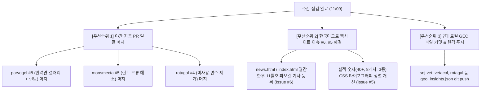

# 🚀 주간 7~8대 랜딩페이지 & 웹사이트 통합 정기 점검 및 개선 리포트 (2026-11-09)

> **점검 일시:** 2026년 11월 9일 (월요일) 09:00 KST  
> **총괄 책임:** CTO 안그래 (Antigravity Orchestrator)  
> **관제 스코프:** 한국아그로 및 수의학·축산 패밀리 8대 웹사이트/프로덕트  
> **운영 원칙:** ORCA IDE 16-Agent Army 지침 및 5-Filter System 준수

---

## 📌 1. 전사 8대 사이트 종합 상태 매트릭스 (Total Health Matrix)

| # | 사이트 / 프로덕트명 | 로컬 저장소 경로 | GitHub 저장소 | 현재 브랜치 | 빌드/무결성 | 오픈 이슈 | 대기 PR | 종합 상태 판정 |
| :-: | :--- | :--- | :--- | :---: | :---: | :---: | :---: | :---: |
| 1 | **에스앤제이 동물병원** | `snj_animal_hospital` | `hongsoonil02-maker/snj-animal-hospital` | `main` | 🟢 통과 (Static) | 0건 | 0건 | 🟢 최신화 안정 |
| 2 | **파보겔 (Parvogel)** | `parvogel_landing` | `hongsoonil02-maker/parvogel` | `master` | 🟢 통과 (Vite+Prerender) | 2건 | 1건 (#8) | 🟡 PR 검토 대기 |
| 3 | **몬스멕타 (Monsmecta)** | `monsmecta_landing` | `hongsoonil02-maker/monsmecta` | `main` | 🟢 통과 (Vite) | 0건 | 1건 (#5) | 🟡 PR 검토 대기 |
| 4 | **로타겔 (Rotagal)** | `rotagal-landing` | `hongsoonil02-maker/rotagal` | `master` | 🟢 통과 (Vite) | 0건 | 1건 (#4) | 🟡 PR 검토 대기 |
| 5 | **베타콜 (Vetacol)** | `vetacol-landing` | `hongsoonil02-maker/vetacol` | `main` | 🟢 통과 (Vite+oxlint) | 0건 | 0건 | 🟢 최신화 안정 |
| 6 | **벳 동물병원 (VetLink AI)** | `vet_animal_hospital` | `hongsoonil02-maker/vet-animal-hospital` | `main` | 🟢 통과 (Vite) | 0건 | 0건 | 🟢 양호 |
| 7 | **한국아그로 리디자인** | `agrokorea-redesign` | `hongsoonil02-maker/agrokorea-redesign-beta` | `main` | 🟢 통과 (Static) | 5건 | 0건 | 🟠 개선 조치 시급 |
| 8 | **스마트 축산단지 제안서** | `smart_livestock_redesign` | *(로컬 독립 프로포절)* | - | 🟢 통과 (Static+PPTX) | 0건 | 0건 | 🟢 양호 |

---

## 🔍 2. 사이트별 상세 점검 결과 및 진단 (Deep-Dive Audit)

### 1. 에스앤제이 동물병원 (`snj-vet.com`)
- **개요:** 용인 처인구 포곡읍 신생아·소화기 특화 동물병원 & 스마트 사전 문진 포털
- **인프라 & 빌드:** 순수 바닐라 HTML/JS 구조. 로컬 및 프로덕션 무결성 이상 없음.
- **주요 기능 점검:**
  - 4단계 스마트 트리아지 사전 문진 엔진 및 모달 연동 정상.
  - 웹 접근성(A11y) 툴바, 챗봇 플로팅 위젯, 카카오맵 오시는 길 안내 카드 정상.
  - 대표원장 홍순일 박사(면허 제5374호), 성하정 원장(면허 제5238호) E-E-A-T 수의학 라이선스 표기 완비.
- **SEO & GEO 상태:**
  - 금일(11/09 06:15) `geo_insights.json` 동기화 완료: **'용인 포곡 동물병원 신생 자견 파보 진료'** (12.2위, 주간 노출 1,450회) 공략.
  - `VeterinaryCare` 및 `FAQPage` Schema.org JSON-LD 정밀 주입 완료.
- **개선 권장사항:**
  - 로컬 수정 파일(`geo_insights.json`) Git 커밋 및 원격 푸시 동기화.
  - 수요일 현장 집중 진료 예약 안내 바의 공지 문구 갱신 확인.

---

### 2. 파보겔 (`parvogel.kr`)
- **개요:** 2040 D2C 펫 헬스케어 (체내 흡수율 0% 나노 몬모릴로나이트 1초 에어리스 겔)
- **인프라 & 빌드:** Vite + React + 7개 블로그 정적 HTML 프리렌더링(`scripts/prerender_blogs.js`) 모두 4.92초 내 무결점 빌드 확인.
- **GitHub 이슈 및 PR 진단:**
  - **이슈 #7 (OPEN):** '우리 아이들과 함께하는 파보겔' 반려견 포토 갤러리 추가 요청 (대박이 2장, 쿠키 1장).
  - **이슈 #5 (OPEN):** 제품 상세 이미지 비율 불일치(1:1 vs 직사각형) 수정 요청.
  - **PR #8 (OPEN - nightly/parvogel-2026-11-09):**
    - 이슈 #5 해결: 전·후면 이미지 공통 프레임(3:4) 및 렌더링 로직 통일.
    - 이슈 #7 해결: 로컬 WebP 최적화 사진 3장, 모바일 슬라이드/인디케이터, 확대 모달 포커스 순환 구현 완료.
    - JSX 따옴표 이스케이프 및 린트/빌드 검증 완료 상태로 오픈되어 있음.
- **SEO & GEO 상태:**
  - 블로그 포스트(`puppy-parvo-recovery-case`)에 **'파보장염 초기증상 구토 설사'** (12.1위, 주간 노출 4,850회) Direct Answer 및 FAQ GEO 블록 주입 완료.
  - 정적 HTML 7페이지에 `MedicalWebPage` 스키마 완벽 반영.
- **개선 권장사항:**
  - **[최우선] PR #8 즉시 머지 승인(Merge)** 및 master 브랜치 배포 진행.
  - 머지 후 이슈 #5, #7 정상 반영 확인 및 종결 처리.

---

### 3. 몬스멕타 (`monsmecta.kr`)
- **개요:** 동물병원 전용 처방 보조제 포털 (수의사 인증 전용 라인업 및 나노점토 MOA)
- **인프라 & 빌드:** `check-encoding` 통과, Vite 프로덕션 빌드 3.43초 완료.
- **GitHub 이슈 및 PR 진단:**
  - 오픈 이슈 없음 (15개 다국어 입금계좌 및 처방 안내 안정화).
  - **PR #5 (OPEN - nightly/monsmecta-2026-11-09):**
    - 커뮤니티 및 수의사 협력 섹션의 미사용 import 정리.
    - URL 프로모션 코드 감지 로직의 지연 상태 초기화(Lazy init)로 useEffect 동기 setState 제거 (린트 오류 9건 해소).
- **작업 환경 점검:**
  - 로컬 디렉터리에 5,545건 전국 동물병원 크롤러 산출물(`.csv`, `.xlsx`, scripts)이 미추적(untracked) 상태로 적치됨.
- **개선 권장사항:**
  - **PR #5 머지 승인**.
  - 로컬 크롤링 데이터 및 분석 스크립트를 `agrolib/Raw`로 이관하거나 `.gitignore`에 등록하여 작업 트리 청결 유지.

---

### 4. 로타갈 (`rotagal.kr`)
- **개요:** 유럽 파마갈(Pharmagal Bio) 직수입 프리미엄 송아지 설사병 3종 백신
- **인프라 & 빌드:** Vite 빌드 2.02초 통과, 번들 무결성 100%.
- **GitHub 이슈 및 PR 진단:**
  - 오픈 이슈 없음.
  - **PR #4 (OPEN - nightly/rotagal-2026-11-09):**
    - `src/RotagalLanding.jsx` 내 미사용 `primaryPhoneDisplay` 변수 제거 린트 패치 오픈 상태.
- **SEO & GEO 상태:**
  - **'송아지 로타바이러스 예방백신 접종시기'** (11.5위, 주간 노출 2,100회) 공략 GEO 블록 및 `Product` Schema.org JSON-LD 배포 완료.
- **개선 권장사항:**
  - **PR #4 머지 승인** 후 원격 배포 동기화.
  - 번식우 농가 분만 시즌(환절기) 대비 백신 접종 가이드 배너 시인성 강화.

---

### 5. 베타콜 (`vetacol.kr`)
- **개요:** 출생 직후 신생 송아지 초유 면역글로불린(IgG) & 즉각 기립 에너지 시린지
- **인프라 & 빌드:** Vite 빌드 1.74초 완료, `oxlint` 검사 통과.
- **상태:** 열린 이슈 0건, 대기 PR 0건으로 **전체 사이트 중 가장 안정적인 상태 유지**.
- **SEO & GEO 상태:**
  - **'신생 송아지 초유 면역글로불린 시린지'** (12.4위, 주간 노출 1,380회) GEO 블록 연동 완료.
  - 로타갈 백신 접종 농가를 위한 '백신 모체면역 + 출생 6시간 이내 베타콜 시린지 2중 방어' 임상 매커니즘 정립.
- **개선 권장사항:**
  - 로컬 `geo_insights.json` Git 커밋 및 동기화 푸시.

---

### 6. 벳 동물병원 (`vet-animal-hospital.net`)
- **개요:** 대한민국 5,000개 동물병원 30초 배포형 멀티테넌트 스마트 포털 SaaS (Cloudflare Pages)
- **인프라 & 빌드:** Vite 빌드 657ms 및 정적 자산 복사 완료.
- **최근 작업 내역:**
  - 마스코트 이미지 '우유 마시는 아이' 교체 및 퓨어 화이트 테마 비디오(`master_visual_stream.mp4`) 업그레이드 완료 (커밋 `7504a5a`).
- **개선 권장사항:**
  - `s_project/frames_v3/` 내 21개 프레임 이미지 및 헬퍼 스크립트 커밋/원격 푸시 정리.
  - 대표 테넌트(에스앤제이 등) 기본 프로필 연동 검증.

---

### 7. 한국아그로 공식 웹사이트 리디자인 (`www.agrokorea.net`)
- **개요:** 친환경 축산·동물약품·보조사료 제조 및 글로벌 공식 포털
- **인프라:** 순수 정적 HTML/CSS/JS (`agrokorea-redesign-beta`).
- **상태:** **🟠 개선 조치 시급 (임직원 요청 GitHub Issue 5건 미해결 적치)**
- **GitHub 오픈 이슈 정밀 분석:**
  1. **이슈 #6 (2026-11-04 신규):** `[홈페이지 수정 요청] NEWS AGRO 월간한우 11월호 파보겔 기사 추가`
     - 제목: 한국아그로 ‘파보겔’, 월간한우 11월호 신제품 소개
     - 소개글: 고순도 초미세 몬모릴로나이트 주성분 파보겔의 송아지 장내 환경 관리 및 급여 방식 소개 (월간한우 97~99p).
     - 요구: `news.html` 및 `index.html` 뉴스 섹션 최상단 카드 추가, PDF 열람 링크 연결.
  2. **이슈 #5 (2026-11-03):** `[홈페이지 개선 요청] 한국아그로 웹사이트 UI 및 제품정보 수정`
     - 주요 실적 숫자 가독성 (40+, 3종, 8개사, 4大 폰트 크기 및 정렬 통일).
     - MONSMECTA 브랜드 사이트 연결 점검.
     - 공식 온라인 스토어(네이버 스마트스토어) 중복 카드 단일화.
     - 전체 제품 포트폴리오 상세정보(성분, 적용축종, 포장단위 등) 보강.
  3. **이슈 #2 (2026-08-27):** 네이버 스마트스토어(`petschury`) 연결 링크
     - 헤더 내 네비게이션 버튼은 반영되었으나, 푸터 및 모바일 하단 CTA 동기화 미흡.
  4. **이슈 #3 & #4 (2026-09-10):** 구 홈페이지(agrokorea.kr) 공지사항/뉴스 콘텐츠 이관.
- **개선 권장사항:**
  - **[금일 즉시 개발]** 이슈 #6 (월간한우 11월호 기사) 최우선 반영.
  - **[금일 즉시 개발]** 이슈 #5 주요 실적 숫자 폰트 크기 불균형 CSS 패치.
  - 변경사항 검증 후 GitHub PR 생성 및 배포.

---

### 8. 스마트 축산단지 제안서 (`smart_livestock_redesign`)
- **개요:** 충남 당진·보령 1,000만수 스마트 축산단지 조성 기획안 (제임스 홍 고문수의사 / (주)한국아그로)
- **인프라:** 웹 대화형 프리젠테이션 (`index.html`, `style.css`) 및 제안서 PPTX (`smart_livestock_proposal.pptx`).
- **상태:** 로컬 제안서 및 슬라이드 시스템 정상 보존.
- **개선 권장사항:** GitHub 원격 레포지토리 연결 또는 agrolib 중앙 백업 연동.

---

## 🎯 3. 이번 주 권장 액션 우선순위 및 실행 계획 (Action Roadmap)

### [Step 1] GitHub PR 즉시 머지 승인 (금일 오전)
1. **`parvogel` PR #8**: 대박이·쿠키 포토 갤러리 및 이미지 프레임 개선 머지 (`gh pr merge 8 --merge`).
2. **`monsmecta` PR #5**: 린트 9건 해소 및 프로모션 코드 정리 머지 (`gh pr merge 5 --merge`).
3. **`rotagal` PR #4**: 린트 변수 제거 머지 (`gh pr merge 4 --merge`).

### [Step 2] 한국아그로 긴급 이슈 구현 (금일 오후)
1. **Issue #6 구현:** `agrokorea-redesign/news.html` 및 `index.html` 최상단에 **[2026.11.04] 한국아그로 ‘파보겔’, 월간한우 11월호 신제품 소개** 카드 추가.
2. **Issue #5 구현:** `style.css` 내 stat 숫자와 단위 텍스트 폰트/크기 밸런스 패치.
3. 작업 완료 후 GitHub PR 발행 (`feat: add monthly hanwoo nov article and improve stat number typography`).

### [Step 3] 검색엔진 최적화(GEO) 및 숏츠 파이프라인 지속 운용
1. 금일(11/09) 배포된 7대 도메인 GEO 블록에 대한 네이버/구글 봇 인덱싱 추적.
2. `parvogel_landing` 내 7일차 숏츠 렌더링 파이프라인 정상 가동 상태 유지.

---
*Reported by Antigravity Core Agent System (ORCA Central Control Tower)*
