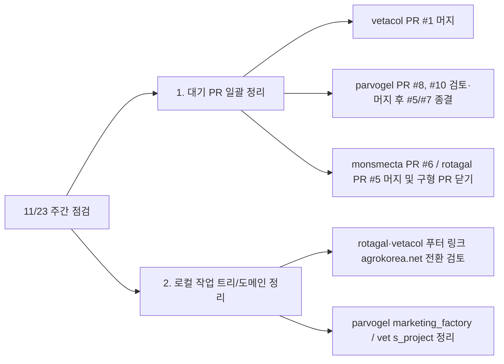

# 🚀 주간 7대 랜딩페이지 & 웹사이트 통합 정기 점검 및 개선 리포트 (2026-11-23)

> **점검 일시:** 2026년 11월 23일 (월요일) 09:00 KST  
> **총괄 책임:** CTO 안그래 (Antigravity Orchestrator)  
> **관제 스코프:** 한국아그로 및 수의학·축산 패밀리 7대 웹사이트/프로덕트  
> **운영 원칙:** ORCA IDE 16-Agent Army 지침 및 5-Filter System 준수

---

## 📌 1. 전사 7대 사이트 종합 상태 매트릭스 (Total Health Matrix)

| # | 사이트 / 프로덕트명 | 로컬 저장소 경로 | GitHub 저장소 | 현재 브랜치 | 빌드 상태 | 린트 상태 | 오픈 이슈 | 대기 PR | 종합 상태 판정 |
| :-: | :--- | :--- | :--- | :---: | :---: | :---: | :---: | :---: | :---: |
| 1 | **에스앤제이 동물병원** | `snj_animal_hospital` | `hongsoonil02-maker/snj-animal-hospital` | `main` | 🟢 정적 HTML 정상 | N/A | 0건 | 0건 | 🟢 안정 |
| 2 | **파보겔 (Parvogel)** | `parvogel_landing` | `hongsoonil02-maker/parvogel` | `master` | 🟢 통과 (Vite+Prerender, 5.46s) | 🟡 `eslint src` 0건 / `eslint .` 388건 (PR #10 등록) | 2건 (#5, #7) | 7건 (#10 신규 등) | 🟡 PR 검토 대기 |
| 3 | **몬스멕타 (Monsmecta)** | `monsmecta_landing` | `hongsoonil02-maker/monsmecta` | `main` | 🟢 통과 (Vite+Encoding, 6.21s) | 🔴 9 errors (`eslint src`) | 0건 | 6건 (#1~#6) | 🟡 PR 머지 필요 |
| 4 | **로타갈 (Rotagal)** | `rotagal-landing` | `hongsoonil02-maker/rotagal` | `master` | 🟢 통과 (Vite, 3.90s) | 🔴 1 error (`primaryPhoneDisplay`) | 0건 | 5건 (#1~#5) | 🟡 PR 머지 필요 |
| 5 | **베타콜 (Vetacol)** | `vetacol-landing` | `hongsoonil02-maker/vetacol` | `main` | 🟢 통과 (Vite, 3.11s) | 🟡 0 errors, 1 warning (PR #1 등록) | 0건 | 1건 (#1 신규) | 🟢 양호 (PR #1) |
| 6 | **벳 동물병원 (VetLink AI)** | `vet_animal_hospital` | `hongsoonil02-maker/vet-animal-hospital` | `main` | 🟢 통과 (Vite+Static Copy, 1.29s) | N/A | 0건 | 0건 | 🟢 양호 |
| 7 | **한국아그로 리디자인** | `agrokorea-redesign` | `hongsoonil02-maker/agrokorea-redesign-beta` | `main` | 🟢 정적 HTML 링크 무결성 통과 | N/A | 0건 (이슈 #1~#6 종결) | 0건 | 🟢 최신화 완료 |

---

## 🔍 2. 사이트별 상세 점검 결과 및 진단 (Deep-Dive Audit)

### 1. 에스앤제이 동물병원 (`snj-vet.com`)
- **GitHub & 작업 트리:** 오픈 이슈 0건, 오픈 PR 0건, 로컬 작업 트리 클린 (`main`).
- **최근 반영 커밋:** `e9fa088` (`copyHospitalAddress` 문법 수정 및 `geo_insights.json` 동기화), `289e23b` (용인 포곡 GEO FAQPage 스키마).
- **품질 점검 (Hero / CTA / 연락처 / 반응형):**
  - **히어로 & CTA:** `index.html` 내 `<h1 class="hero-title">` ("검색으로 불안해지기 전에 수의사 기준의 행동 가이드를 먼저 확인하세요"), 스마트 사전 문진 CTA 및 `tel:031-321-6562` 연결 정상.
  - **연락처·인허가 안내:** 대표전화 `031-321-6562`, 긴급 핫라인 `010-5407-5708`, 사업자등록번호 `792-66-00615`, 개설신고확인증 `제 5620000-010-2025-0002 호`, 홍순일 원장(면허 제5374호)·성하정 수의사(면허 제5398호) 표기 일관성 확인.
  - **반응형 & 에셋:** `style.css`·`partner.css`·`widgets.css` 내 모바일 `@media` 브레이크포인트(960px/768px/640px/420px) 및 `overflow-x: hidden` 적용. 단, 레거시 파일 `parvogel-notice-A4-original.html` 내부 `dm-qr-naver.png` 파일이 로컬에 부재함(실사용 `parvogel-notice-A4.html`에는 영향 없음).

### 2. 파보겔 (`parvogel.kr`)
- **빌드 & 린트:**
  - `npm run build`: **통과** (5.46s, Vite 번들 + `scripts/prerender_blogs.js` 블로그 7개 정적 HTML 프리렌더링 완료).
  - `npm run lint` (`eslint .`): **실패 (388 errors)** — `npx eslint src`는 **0 errors**이나, `eslint.config.js`의 `ignores`에 `apps`가 빠져 있어 `apps/parvogel-petcare-vip` 하위 빌드 산출물(`android/app/src/main/assets/public/...`, `dist/...`)까지 스캔됨.
- **GitHub 상태:**
  - 오픈 이슈 2건: `#7` (반려견 포토 갤러리 추가), `#5` (제품 상세 이미지 크기 불일치 수정).
  - 기존 오픈 PR 6건: `#9` (`nightly/parvogel-2026-11-17`), `#8` (`nightly/parvogel-2026-11-09` — #5/#7 대응), `#6`, `#4`, `#3`, `#1`.
- **자동 수정 PR 등록:**
  - **신규 PR #10 (`fix/weekly-auto-2026-11-23`):** `fix(주간자동): eslint.config.js ignores에 apps 경로 추가하여 린트 오류 해소` ([PR #10](https://github.com/hongsoonil02-maker/parvogel/pull/10)). 워크트리에서 `npm run lint` (0 errors) 및 `npm run build` 검증 완료.
- **품질 점검 (Hero / CTA / 계좌 / 반응형):**
  - **히어로 & CTA:** `src/pages/Landing.jsx` 내 B2C 반려동물 응급 상비겔 카피(`c3a9c1e`), 카카오 쇼핑하기·쿠팡 로켓배송·네이버 스마트스토어 3종 CTA 정상 구성.
  - **계좌·연락처:** `src/components/OrderForm.jsx` 무통장 입금 계좌 `농협 301-0133-0281-01 (예금주: (주)한국아그로)` 및 `010-5407-5708` 정상 노출.
  - **반응형:** `grid-cols-1 sm:grid-cols-3`, `lg:grid-cols-12`, `break-keep` 적용 양호.
- **운영 주의사항:** `dist/index.html`이 Git에 추적되어 있어 빌드 시마다 워킹 트리에 변경이 발생하며, `marketing_factory/` 하위 수정/미추적 파일들이 로컬에 적치되어 있음.

### 3. 몬스멕타 (`monsmecta.kr`)
- **빌드 & 린트:**
  - `npm run build`: **통과** (`check-encoding.cjs` 인코딩 무결성 OK + Vite 빌드 6.21s).
  - `npm run lint` (`eslint src`): **실패 (9 errors)** — 미사용 `React`/`useEffect`/`setRating`/`toggleShowPrice`/`isPriceRevealed` 및 `VetCollaborationSection.jsx` 내 `react-hooks/set-state-in-effect`.
- **GitHub 상태:**
  - 오픈 이슈 0건.
  - 오픈 PR 6건 (`#6` `nightly/monsmecta-2026-11-17` ~ `#1`) — 현재 `main`의 린트 오류 9건을 해결하는 야간 자동 PR이 이미 등록되어 머지 대기 중(중복 PR 생성 생략).
- **품질 점검 (Hero / CTA / 연락처 / 반응형):**
  - **히어로 & CTA:** `src/components/Hero.jsx` 내 발주(`#order`), 원장님 무료 샘플, 스펙/라벨 모달 3종 CTA 및 `StickyBottomCTA` 정상.
  - **연락처·발주 안내:** B2B 동물병원 전용 포털로서 `OrderForm.jsx`에 최소 발주 수량 안내 및 `에스앤제이 동물병원 원장 직통 유선 (031-321-6562)` 협의 프로세스 정상 표기.
  - **반응형:** `pt-4 pb-8 sm:pt-8 sm:pb-12 md:py-[76px]`, `flex-col md:flex-row`, `Footer.jsx` 하단 `safe-area-inset-bottom` 여백 확보 정상.
  - **로컬 상태:** `apps/`, `scratch/sync_agrolib.py` 미추적 파일 존재.

### 4. 로타갈 (`rotagal.kr`)
- **빌드 & 린트:**
  - `npm run build`: **통과** (3.90s).
  - `npm run lint` (`eslint .`): **실패 (1 error)** — `src/RotagalLanding.jsx:296` 미사용 변수 `primaryPhoneDisplay`.
- **GitHub 상태:**
  - 오픈 이슈 0건, 오픈 PR 5건 (`#5` `nightly/rotagal-2026-11-17` ~ `#1`). `PR #5`가 `MERGEABLE (CLEAN)` 상태이므로 중복 PR 생성 대신 `#5` 즉시 머지 권장.
- **품질 점검 (Hero / CTA / 연락처 / 반응형):**
  - **히어로 & CTA:** `RotagalLanding.jsx` 내 EU GMP 배너, 임신우 1회 원샷 백신 타이틀, `#inquiry`·접종적기 계산기·영상·리플릿 PDF CTA 4종 정상.
  - **연락처:** 도별 총판 연락처 테이블, `TEL: 02-6949-5706 / Mobile: 010-5407-5708`, `info@agrokorea.kr` 표기 정상. (단, 푸터 웹 링크가 `http://www.agrokorea.kr`로 되어 있어 향후 `https://www.agrokorea.net` 전환 검토 권장).
  - **반응형:** `text-[1.45rem] sm:text-4xl ...`, `overflow-hidden`, `pb-28 sm:pb-14` 하단 스티키 바 간섭 방지 적용.

### 5. 베타콜 (`vetacol.kr`)
- **빌드 & 린트:**
  - `npm run build`: **통과** (3.11s).
  - `npm run lint` (`oxlint`): 0 errors, **1 warning** (`src/components/AccessibilityWidget.jsx:14` 미사용 `FONT_LEVELS` 상수).
- **자동 수정 PR 등록:**
  - **신규 PR #1 (`fix/weekly-auto-2026-11-23`):** `fix(주간자동): AccessibilityWidget 미사용 FONT_LEVELS 상수 제거` ([PR #1](https://github.com/hongsoonil02-maker/vetacol/pull/1)). 수정 후 `oxlint` **0 warnings, 0 errors** 및 `npm run build` 통과 확인.
- **품질 점검 (Hero / CTA / 연락처 / 반응형):**
  - **히어로 & CTA:** `VetacolLanding.jsx` 내 한우/젖소 송아지 초유 타겟 배지, VETALIS 공식 보증 박스, 쿠팡 구매 CTA(`COUPANG_URL`) 및 `StickyBottomCTA` 정상.
  - **연락처:** `02-6949-5708`, `010-5407-5708` (`src/constants.js` 중앙 관리) 정상. (로타갈과 동일하게 `AGROKOREA_URL`이 `http://www.agrokorea.kr`로 설정되어 있어 리디자인 도메인 통합 여부 점검 권장).
  - **반응형:** 챗봇 모달 `max-w-[calc(100vw-2rem)]`, `pb-32 sm:pb-24` 푸터 여백 확보 등 모바일 대응 양호.

### 6. 벳 동물병원 (`vet-animal-hospital.pages.dev`)
- **빌드 & 린트:**
  - `npm run build` (`vite build && node ./scripts/copy-static.mjs`): **통과** (1.29s). `package.json` 내 `lint` 스크립트는 미구성.
- **GitHub & 로컬 상태:** 오픈 이슈 0건, 오픈 PR 0건. 로컬 `s_project/` 하위 이미지·영상 및 스크립트(`export_slides.ps1`, `fetch_photo.py`) 수정/미추적 상태 유지 중.
- **품질 점검 (Hero / CTA / 연락처 / 반응형):**
  - **히어로 & CTA:** `index.html` 30초 포털 미리보기(`#studio`), 파트너 무상 조건(`#pricing`) CTA 및 3열 라이브 목업 카드 정상.
  - **연락처 & 에셋:** `010-5407-5708`, `info@vet-animal-hospital.net` 표기 정상. `./favicon.png` 참조 파일은 `public/favicon.png`에 존재하여 빌드 시 정상 복사됨 확인. (`index.html:250` 스튜디오 체험 입력칸의 기본값 `02-1234-5678`은 데모용 입력값).
  - **반응형:** `assets/css/style.css` 내 `@media (max-width: 768px)`에서 `.hero-mockup-grid { grid-template-columns: 1fr !important; }`로 1열 전환 정상 적용.

### 7. 한국아그로 공식 웹사이트 리디자인 (`www.agrokorea.net`)
- **GitHub 상태:** 지난 점검(11/09) 당시 적치되어 있던 **이슈 #1~#6 전건이 2026-11-20 일괄 해결 및 종결(CLOSED)** 되었고, PR `#7` (`8bfb10b`) 머지로 메인 브랜치 최신화 완료. 현재 오픈 이슈 0건, 오픈 PR 0건.
- **정적 HTML & 링크 무결성 점검:**
  - 루트 및 `en/` 전체 HTML 파일 대상 내부 링크/이미지/PDF 경로 전수 검사 결과 **누락(Broken Link) 0건**.
  - 헤더/모바일 메뉴 네이버 스마트스토어(`petschury/profile`) CTA, 대표번호 `02-6949-5708`, 이메일 `name_hyosun@naver.com`, 월간한우 11월호 파보겔 기사(`news.html`), 공지사항 통합(`notices.html`) 모두 정상 반영 확인.
  - 반응형 CSS (`css/style.css`) 내 `overflow-x: hidden`, `word-break: keep-all`, `1080px / 768px / 680px / 440px` 미디어 쿼리 완비.

---

## 🛠️ 3. 금일 자동 수정 PR 내역 및 주간 액션 로드맵

### 금일 신규 등록 PR (2건)
1. **베타콜 (`vetacol`) PR #1:** `fix(주간자동): AccessibilityWidget 미사용 FONT_LEVELS 상수 제거` — [PR 확인](https://github.com/hongsoonil02-maker/vetacol/pull/1) (`oxlint` 0 warning 달성)
2. **파보겔 (`parvogel`) PR #10:** `fix(주간자동): eslint.config.js ignores에 apps 경로 추가하여 린트 오류 해소` — [PR 확인](https://github.com/hongsoonil02-maker/parvogel/pull/10) (`npm run lint` 388 error 해소)

### 이번 주 권장 후속 조치 (우선순위)

1. **즉시 머지 대상 PR:**
   - `vetacol` **PR #1** (신규), `rotagal` **PR #5** (`CLEAN`), `monsmecta` **PR #6**, `parvogel` **PR #8** & **PR #10**.
   - 머지 후 각 저장소에 누적된 이전 날짜 야간자동 PR(`parvogel` #3/#4/#6/#9, `monsmecta` #1~#5, `rotagal` #1~#4) 일괄 Close 권장.
2. **도메인 일관성 점검:**
   - `rotagal-landing` 및 `vetacol-landing` 푸터/상수의 한국아그로 URL(`http://www.agrokorea.kr`)을 리디자인 공식 도메인(`https://www.agrokorea.net/`)으로 통일할지 결정 필요.
3. **로컬 작업 트리 위생:**
   - `parvogel_landing`의 `dist/` 추적 여부 재검토 및 `marketing_factory/` 산출물 정리, `monsmecta_landing` 내 `apps/`·`scratch/` 정리, `vet_animal_hospital` 내 `s_project/` 커밋/정리 권장.

---
*Reported by Antigravity Core Agent System (ORCA Central Control Tower)*
