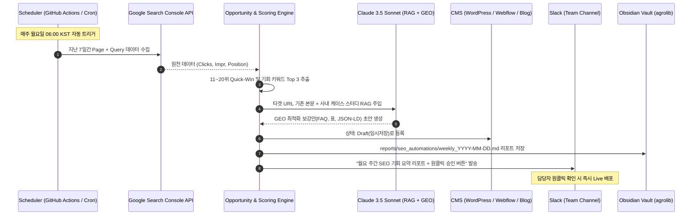

# 🚀 주간 AI SEO & GEO 운영체제 자동화 파이프라인 명세서 (Weekly Automation)

> **담당:** CTO 안그래 (Antigravity)  
> **목적:** 매주 월요일 랜딩페이지 점검 자동화(`weekly-landing-audit`)와 연계하여, GSC 순위 분석 및 2페이지(11~20위) 기회 키워드 콘텐츠 보강을 무인 자동화.

---

## 1. 주간 실행 타임라인 (매주 월요일 무인 사이클)

---

## 2. 세부 자동화 단계

### Step 1. 매주 월요일 06:00 - GSC 데이터 인제스천
- 지난주 월~일 7일간 구글 검색 콘솔의 실적 데이터를 `['page', 'query']` 페어로 자동 덤프.
- 전주 대비 순위 변동폭(`delta_position`) 및 노출 증가율 계산.

### Step 2. 06:30 - 기회 스코어링 & 3대 공략 대상 선정
- **Track 1 (기존 글 보강 Top 2):** 평균 순위 11.0~18.0 사이이면서 노출량이 높은 기존 포스트 2건 선정.
- **Track 2 (신규 공백 포스트 Top 1):** 신규 노출이 급증했으나 연결된 전용 랜딩이 없는 롱테일 키워드 1건 선정.

### Step 3. 07:00 - RAG 결합 및 GEO 초안 자동 생성
- 사내 케이스 스터디 DB(`agrolib/reports`, 임상 사례, 실제 수치)를 컨텍스트로 자동 검색하여 주입.
- 단순 글 생성이 아닌 **"Direct Answer 요약 + 비교 표 + FAQ + FAQPage Schema"**를 갖춘 마크다운 생성.

### Step 4. 07:30 - CMS Draft 등록 & Obsidian 리포트 생성
- 타겟 CMS에 `Draft(비공개 초안)` 상태로 적재.
- `C:\Users\master\agrolib\reports\seo_automations\weekly_YYYY-MM-DD.md`에 주간 분석 보고서 자동 적재.

### Step 5. 08:00 - 슬랙 알림 발송
- 슬랙 웹훅으로 아래 형태의 주간 브리핑 전송:
  > **[주간 AI SEO 리포트] 이번 주 공략할 11~20위 키워드 3건이 발굴되었습니다.**  
  > 1. `파보장염 초기증상` (현재 12.4위 / 노출 1,820회) -> 기존 칼럼 보강 초안 완료  
  > 2. `새끼강아지 노란토` (현재 14.1위 / 노출 950회) -> 기존 칼럼 보강 초안 완료  
  > 3. `강아지 설사 상비약` (신규 16.8위 / 노출 520회) -> 신규 포스트 초안 완료  
  > 👉 [초안 미리보기] | [원클릭 즉시 승인 및 배포]

---

## 3. 구현 방식 (안티그래비티 상주 스케줄러 & GitHub Actions)

1. **Antigravity 내부 스케줄러 (`schedule` 도구):**
   - Cron: `0 6 * * 1` (매주 월요일 오전 6시)
2. **클라우드 무인 자동화 (GitHub Actions):**
   - `.github/workflows/weekly-seo-automation.yml`
   - 로컬 PC가 꺼져 있어도 GitHub 러너에서 정기적으로 실행 가능.
